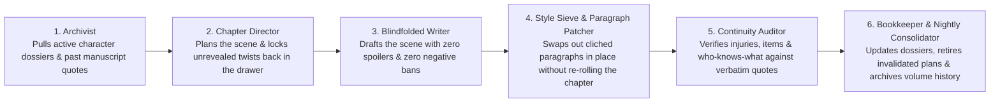

# NarrateOS

**Turn AI into Your Dedicated Long-Form Fiction Writers' Room — From a One-Line Premise to a Million-Word Serial Without Plot Holes, Leaked Twists, or Robotic Prose**

[简体中文](./README.md) | [English](./README.en.md)

---

## Why Does Writing a Novel in a Single AI Chat Fall Apart by Chapter 10?

Anyone who has tried writing a long-form novel in a standard AI chat window hits the same three walls within a dozen chapters:

1. **Amnesia & Continuity Drift**: The protagonist loses his left arm in Chapter 3, then casually draws a sword with his left hand in Chapter 8. By Chapter 50, early clues and side characters are buried under a mountain of chat history.
2. **Premature Spoiler Leaks**: You plan a slow-burn twist where the student council vice president secretly locked the fourth-floor music room three years ago — a reveal saved for Chapter 45. The moment you feed that lore into the prompt, the AI blurts it out in an internal monologue in Chapter 2. Even if you beg it *"DO NOT SPOIL THIS"*, it fixates on the prohibition and drops heavy-handed hints in every line of dialogue.
3. **Robotic Cliches & The Domino Effect of Edits**: Characters gradually lose their distinct voices and start sounding like the same generic AI narrator. Worse, if you manually rewrite a key line in Chapter 12, the next twenty chapters crash like dominoes.

**The root cause is simple: you are asking a single AI prompt to be the omniscient showrunner, the scene writer, and the continuity archivist all at once.**

Built on `@deepseek-ai/dsh`, **NarrateOS** replaces that single overloaded prompt with a **compartmentalized Writers' Room**: one specialist pulls the files, one directs the scene and locks away future twists, one writes the prose blindfolded to spoilers, and one audits every factual claim verbatim against your past chapters.



---

## How a Novel Is Born and Survived in the Writers' Room

Imagine you want to write a long-form mystery: *"Three years ago, the student council vice president secretly locked the fourth-floor music room. In Chapter 1, the protagonist finds the brass key on a rainy afternoon — and the truth behind that locked door must stay hidden until Chapter 45."*

### Act I · The Pilot Episode: Don't Fill Out a 20-Page Questionnaire — Shoot Chapter 1 First
You walk into the main chat room with that single sentence. The **Showrunner** won't interrogate you with an endless worldbuilding form. Instead, like a TV series creator, they help you nail down the opening camera shot (who is standing where in minute one, and what is in their hand), give each character a private agenda and a plausible misjudgment, and break the opening arc into a handful of flexible story beats.

Once the book repository is initialized, the room shoots **Chapter 1 as your Pilot Episode** and pauses for your review:
- Does the dialogue sound right? Is the pacing too rushed?
- If you tweak a few lines of dialogue directly in the manuscript, the room harvests your favorite turns of phrase into a rolling voice pool so future chapters naturally adopt your cadence. If the opening angle feels off, tell the Showrunner and reshoot the pilot on the spot.

### Act II · Blindfolding the Writer: Making Spoiler Leaks Physically Impossible
By Chapter 15, the protagonist brings the brass key to the student council room to probe the vice president. How do you get razor-sharp subtext without the AI accidentally confessing the three-year-old secret?
- First, the **Archivist** pulls the history of the brass key and the exact lines from their previous encounters.
- Next, the **Chapter Director** consults the master blueprint behind closed doors, maps out the scene, and **locks the three-year-old secret back in the drawer**. The Director hands the Writer only an actionable performance sheet: *"Show the vice president's knuckles whitening around her teacup when she spots the key on the desk, then using school regulations to change the subject."*
- Finally, the **Writer** drafts the prose inside a cleanroom with zero access to the secret blueprint and zero *"do not mention X"* instructions. **Because the Writer literally does not know the answer to the mystery, it cannot spill the secret** — pouring all of its attention into the teacup, the eye contact, and the verbal sparring.

### Act III · Verbatim Fact-Checking & Rewriting Old Chapters Without Fear
As soon as the draft is finished, it passes through a deterministic **Style Sieve**. If two paragraphs slip into repetitive AI cliches, the **Paragraph Patcher** surgically replaces just those two paragraphs in memory rather than throwing away the whole chapter.

Then the **Continuity Auditor** steps in. The Auditor never judges literary taste; it only enforces hard facts — and every single objection must cite **both the exact quote in the new draft and the exact quote in your past chapters or dossiers** (hallucinated accusations are rejected on the spot):
- *The dossier states she is terrified of the dark — how is she calmly standing alone in a windowless room after the power cut?* -> Sent back for patching!
- *Only the protagonist and his best friend know about the brass key — why is a newly introduced freshman mentioning it?* -> Sent back for patching!

And what if, at Chapter 40, you suddenly open **Chapter 12** by hand and change *"he locked the key in the iron cabinet"* to *"he handed the key to his best friend"*? Click **Sync**, and the room won't overwrite your later chapters. Instead, it scans Chapters 13 through 40, pinpoints the exact scenes that still mention prying open the iron cabinet, and lets you decide whether to patch those paragraphs in place or re-run the affected chapters under your supervision.

### Act IV · Crossing 100 Chapters Without Amnesia or Context Bloat
How does a novel reach a million words without drowning in its own history?
- **Shared Secrets Stay Alive Across Cards**: Long-term private alliances (such as *"the best friend learned the protagonist's secret in Chapter 10"*) are stored in a single place of truth. Even if the protagonist is completely absent in Chapter 30 and the chapter is written from the best friend's perspective, the room automatically projects that shared memory into the best friend's view.
- **Butterfly-Effect Rescheduling**: If the protagonist blows up the villain's hideout ahead of schedule or skips ahead three years, the Director flags the disrupted future events. At the end of the chapter, the **Nightly Consolidator** wakes up, crosses off the invalidated schemes, and writes the villain's next counter-move into the schedule.
- **Traveling Light Between Volumes**: When a volume wraps up and the story moves to a new stage, resolved plot threads are sealed into the volume ledger, while retired characters and idle items move into dormant storage so they don't clutter the new volume. When that retired janitor pushes open the door again in Chapter 200, a one-line dormant card lets the Archivist wake him right back up with every scar and memory intact.

---

## Your Two Seats in the Writers' Room

You can switch between two workspaces at any point in the creative process:

| Workspace | What You Do Here | Everyday Actions |
| :--- | :--- | :--- |
| **DSH Main Chat**<br/>(Showrunner's Office) | Brainstorm a new premise, calibrate your Chapter 1 pilot, make major mid-volume course corrections, or drive the room via slash commands | Switch to **NarrateOS Creative Mode** and talk to the Showrunner; or run `/narrate-step`, `/narrate-yolo 5`, `/narrate-sync`, `/narrate-signal <note>` |
| **Operator Studio**<br/>(`/studio` Browser Workbench) | Three-pane visual control room: watch the 6-stage pipeline and reasoning traces on the left, read or hand-edit manuscripts in the center, and browse live character cards, open threads, and schedules on the right | Click **Write Next Chapter / YOLO** in the top bar; switch to **Edit Manuscript -> Save & Sync** in the center pane; or drop a sticky note at the bottom (e.g., *"Stop the rain next chapter and bring in the night watchman early"*) |

> **Strict Separation of Engine and Books**: This repository contains only the generic writers' room engine and role presets. Every novel you create lives in its own standalone Git repository under `books/<book-slug>/`, giving every settled chapter and dossier update a clean version history.

---

## Quick Start in 3 Steps

### Prerequisites
- **Node.js**: `>= 22` (Node 24 recommended)
- **pnpm**: `10.33.0+`
- **Git**: Required for per-book chapter commits, state ledgers, and rollback recovery

### 1. Install & Build

```bash
pnpm install --frozen-lockfile
pnpm run build
```

### 2. Launch the Isolated Sandbox (Main Chat + Operator Studio)

Configure your model credentials via environment variables or a gitignored `.env` file in the repository root, then start the sandbox server:

```bash
# Initialize and verify the sandbox directory only (defaults to /tmp/narrateos-sandbox)
pnpm run dev:sandbox -- --init-only

# Start the sandbox server (optionally set PORT, e.g. PORT=42893)
PORT=42893 pnpm run dev:sandbox
```

Open the authenticated local URL printed in your terminal:
1. In the **Main Chat Workbench**, switch to **NarrateOS Creative Mode** (`narrateos`) and pitch a one-line story idea to start a new book.
2. Click the **NarrateOS Studio** icon in the left activity bar (or open `/studio`) to enter the visual control room, step through chapters, hand-edit prose, inspect the Codex, or tune per-role model routing.

### 3. Run Verification Gates & Tests (For Developers)

Before committing engine changes, run the unified verification command (chaining package builds, TypeScript typechecking, repository lint gates, preset validation, and all unit test suites):

```bash
pnpm run check
```

Individual developer commands:

```bash
pnpm run build        # Build all 4 workspace packages and bundle Studio client modules
pnpm run typecheck    # Build and run TypeScript typechecking across all packages
pnpm run lint         # Run deterministic repository lint checks
pnpm test             # Run unit tests, preset tests, and release gate checks
ssot check design     # Verify formal C4 architecture, VDM-SL contracts, and Quint recovery models
```

---

## Repository & Book Map (Developer Quick Reference)

### Engine Repository Layout

```text
.
├── packages/
│   ├── dsh-book-store/          # Plain-text book database: dossier parser, POV & timeline slicing, manuscript recall, style sieve & Git transactions
│   ├── dsh-book-tools/          # Controlled toolbelt: filesystem fences, read quotas, in-memory paragraph patching, staging sessions & handoff gates
│   ├── dsh-pipeline/            # Production pipeline: 6-stage chapter orchestration, post-chapter consolidation, manuscript sync, self-healing & slash commands
│   └── dsh-client-ui-studio/    # Operator Studio three-pane browser workbench UI
├── presets/
│   └── dsh-preset-narrateos/    # Top-level DSH mode preset, 8 externalized role configs (roles/*.yml & prompts/*.md), and narrate-boot skill
├── plugins/craft/               # Optional per-book narrative craft plugins (subtext, sensory grounding, scene beats, emotional motivation)
├── design/                      # SSoT formal architecture (C4), invariants, port contracts (VDM-SL), and crash-recovery wiring (Quint)
└── docs/                        # Deep-dive architecture specs, prose craft lexicon, visual design system, and roadmap
```

### Inside a Book Repository (`books/<slug>/`)

Every novel is a human-readable plain-text (`Markdown` / `YAML` / `JSONL`) Git repository that you can inspect or edit in any text editor:
- `manuscripts/`: Settled chapter manuscripts (`ch_0001.md` onward — the ultimate source of truth for everything that has happened in the story).
- `world/`: The Author Charter, the Director's stage plan and opening beats, the writer-facing volume envelope, prose baseline, current world state, active foreshadowing ledger, and default future event schedule.
- `lore_library/`: On-demand worldbuilding encyclopedia entries (with support for tucking unrevealed high-level secrets at the bottom of an entry, automatically hidden from the Writer).
- `entities/`: Four-section character and key item dossiers (innate red lines, current state & ledgers, life-changing milestones, and recent memory buffer + dialogue voice), plus dormant cross-volume dossiers (`cold_archive/`).
- `index/`: Saga summaries, volume ledgers (including archived resolved plot threads), and per-volume chapter summary cards.
- `.ops/`: Runtime operational ledger (transaction locks, rolling voice sample pool, author steering notes, manuscript sync conflict reports, and per-chapter prose health metrics).

---

## Deep-Dive Documentation Index

For the formal contracts, isolation boundaries, and engineering invariants behind the Writers' Room:

- **Workflows, Data Contracts & the "3+1" Narrative Cognitive System**: [docs/ARCHITECTURE.md](./docs/ARCHITECTURE.md)
- **Prose Craft Discipline, Voice Rolling & Static Gate Lexicon**: [docs/WRITING-CRAFT.md](./docs/WRITING-CRAFT.md)
- **Domain Glossary (16 Core Terms)**: [ROADMAP.md](./ROADMAP.md)
- **DSH Plugin Contracts, Role Schemas & Phase 5 Roadmap**: [docs/DEVELOPMENT-PLAN.md](./docs/DEVELOPMENT-PLAN.md)
- **Product Boundaries & Operator Studio Visual System**: [docs/impeccable/PRODUCT.md](./docs/impeccable/PRODUCT.md), [docs/impeccable/DESIGN.md](./docs/impeccable/DESIGN.md)
- **Formal Architecture & Recovery Models (SSoT)**: [design/](./design/)
- **Coding Standards & Code Review Invariants**: [CODING_STANDARDS.md](./CODING_STANDARDS.md)
