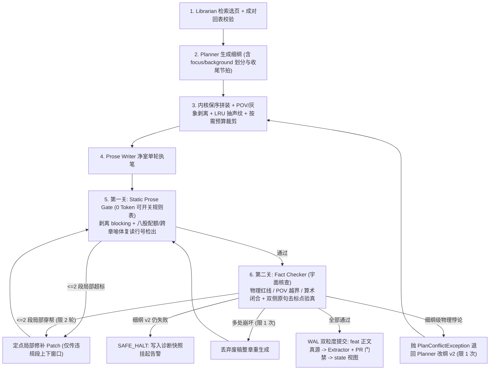

# NarrateOS 业务流与领域数据契约规范 (ARCHITECTURE)

> **定位**：面向百万至亿字级规模、模型无关、与编程语言及运行时宿主完全解耦的通用长篇小说创作业务规范。
> **阅读指引**：领域词汇与裁决基线见 [`../ROADMAP.md`](../ROADMAP.md)；微观文风与静态门禁词典见 [`WRITING-CRAFT.md`](WRITING-CRAFT.md)；软件工程模块划分与开发计划见 [`DEVELOPMENT-PLAN.md`](DEVELOPMENT-PLAN.md)；外部论文与底座数据见 [`RESEARCH.md`](RESEARCH.md)。

---

## 1. 架构公理与三层职责分工

长篇小说创作兼具自由文学表达与严格因果约束：**已归档手稿是唯一剧情事实真源（`WAL`）**，而物理排他状态、时空可达性、视角认知边界与句法配额共同构成确定性护栏。

### 1.1 四大业务公理

1. **单模同构公理（Bootloader 吃脏活，运行时零分支）**：不在运行时区分“原创模式”与“同人模式”。无论是零基础一句话脑洞，还是几十万字外部同人设定包，一律在开书第 0 步（Bootloader）编译为标准作品工作区，运行时 100% 统一调度。
2. **缓存复用与净室解耦公理**：后台检索与离线整理利用前缀缓存低成本读取分级目录（压在 `<100K Tokens` 内规避长窗口阶梯溢价）；负责文学表达的执笔写手（Prose Writer）强制采用**无对话历史、零工具声明**的单轮净室调用，由可配置的窗口预算（`writer_token_budget`）配合分级降级链抑制注意力稀释与思考块污染。
3. **纯文本数据库与双粒度事务公理**：每部作品独立存放于各自的 `books/<slug>/` Git 仓库。定稿手稿为最高事实真源（支持人工直接编辑并通过 `Sync` 平账），实体档案与目录为派生物化视图（遵循**环境补集原则**：相邻章尾窗可见的临时站位与动作绝不重复抄录）。单章正文落盘与视图更新拆为两次独立原子提交，由预写相位锁（WAL）保障崩溃恢复一致性。
4. **审美与字面校验权责分离公理**：严禁轻量模型评判文学优劣或潜台词；凡确定性规则能判定的标签剥离、配额扫描、视角裁剪、外键可达性与原句存在性，一律收归零模型开销的确定性内核执行。

### 1.2 三层执行单元矩阵

仅 `Planner` 与 `Prose Writer` 共享同一强模型创作前缀池；`Librarian`、`Fact Checker`、`Dreamer` 的前缀池物理独立，天然支持配置**跨厂商异构模型互相挑刺**以对冲单一模型的预训练盲区。

| 执行单元 | 能力档位 | 窗口特征 | 核心职责与输出契约 |
| :--- | :--- | :--- | :--- |
| **确定性内核** | 纯规则逻辑 | `0 Token` | 动静保序拼装前缀、声纹标本 `LRU` 轮换、超预算按需降级裁剪、POV 底牌物理剥离、`WARPED` 灰象剥离、`story_day` 偏序过滤、跨称谓 `ripgrep` 回表、静态文风配额扫描、固有属性写保护与外键校验、WAL 双粒度提交、`Sync` 哈希检测、零模型遥测采集 |
| **1. Librarian 选页员** | 轻量快模型 | `<100K` | 通读多级目录索引与词条摘要，输出本章所需的设定词条 ID、需唤醒的冷宫旧实体 ID 及需回表的原稿查询条件 |
| **2. Planner 章节导演** | 旗舰强模型 | 单轮净室 | 零工具声明（与写手共享静态前缀），结合卷纲刻度、惯性表（含 `WARPED` 偏转推演）、前台切镜信号与圆谎纸条，输出含 `timeline_mode`、弹性字数、`focus_cast / background_cast` 划分、戏眼配额及收尾节拍的结构化细纲 |
| **3. Prose Writer 写手** | 旗舰强模型 | 单轮净室（受 `writer_token_budget` 管控） | 零工具单轮生成：头部输出 100 字 `<blocking>` 空间走位自检，随后输出停在具象感官画面的纯净章节正文（或针对违规段落输出定点 `Patch` 替换块） |
| **4. Fact Checker 核查兵** | 轻量/异构模型 | 单章局部窗口 | **零审美评判**；仅锁定最新单章草稿核对物理伤残红线、视角认知越界、专有名撞车、显式数字算术闭合，并提交双侧原文子串供内核做去标点存在性验真 |
| **5. Extractor / Dreamer** | 旗舰/异构强模型 | 单章提取 / 离线整理 | 单章定稿后输出行级状态补丁与双轨章卡（经内核 PR 门禁校验）；达水位时触发离线 `Dreaming` 清洗脏实体页、归档过期死元组、抛 `Spotlight Trigger` 并执行跨章连续性三级自动自愈 |

---

## 2. 作品工作区纯文本数据库结构与原子事务协议

每部作品的全部设定、索引、实体视图与手稿真源均以 **UTF-8 纯文本（Markdown / YAML / JSONL）** 存储在独立的 `books/<slug>/` Git 仓库中：

```text
books/<book-slug>/                 # 独立 Git 仓库（与引擎源码物理隔离）
├── world/
│   ├── book_config.yaml           # [作品可配变量] 窗口预算、自动回滚阈值、craft_plugins、异构模型路由表
│   ├── static_base_and_voice.md   # [静态前缀 #1] 世界底层法则、空间连通拓扑、抽象句法纪律（整卷零变动）
│   ├── current_arc_envelope.md    # [静态前缀 #2] 当前卷纲要、冲突烈度边界与阶段锁（换卷更新）
│   ├── voice_samples.yaml         # [动态声纹池] 0~N 条自由标签短句法标本（按 LRU 轮换挂载）
│   ├── ops_style_amendments.md    # [动态首段] 卷中新增的长期风格修订（换卷合入前缀 #1）
│   ├── world_state.md             # 全局当前日历锚点（含整数 story_day）与宏观局势摘要
│   ├── future_horizon.md          # 世界默认惯性表（统一承载原创倒推拐点与同人 T0 后预定事件）
│   └── open_threads.md            # 跨卷必收伏笔台账（含唤醒条件与冷档指针，永不被 L0 折叠裁除）
├── lore_library/
│   └── lore_*.md                  # 静态世界书词条库（仅由 Librarian 挑页挂入动态尾部，严禁前插击穿缓存）
├── index/
│   ├── L0_sagas.md                # 纪元折叠总表（每满 10 卷封存一纪元，支撑亿字级收敛）
│   ├── L1_volumes.md              # 活跃卷级总表（记录卷名、地图舞台、story_day 跨度与收束结果）
│   └── L2_cards/
│       └── vol_01_cards.md        # 按卷分片双轨章卡（主干剧情 + 反常异象锚点与节拍指纹）
├── entities/
│   ├── char_001.md                # 不可变 entity_id 命名：四段式角色病历与欠条视图
│   ├── item_001.md                # 唯一性关键证物/道具视图（普通消耗品与未转正路人不建独立文件）
│   └── cold_archive/              # 退场休眠角色、过期 WARPED 归档与主角旧纪元分片履历
├── manuscripts/
│   └── ch_0001.md                 # [WAL 唯一真源] 剥离工程标签后的章节定稿（支持人工直接编辑）
└── .ops/
    ├── tx_state.json              # 原子事务预写相位锁（WAL）与章节 SHA-256 指纹表
    ├── signals.jsonl              # 外部微调指令、圆谎纸条与 Spotlight Trigger 队列（安全点消费）
    ├── parallel_deltas/           # PARALLEL 并行时间线窗口内的分支状态增量暂存区
    └── telemetry.jsonl            # 每章零模型开销采集的健康度与缓存遥测流水
```

### 双粒度 Git 提交与 WAL 崩溃恢复契约

单章落盘严格拆分为两次独立原子提交，由 `.ops/tx_state.json` 记录相位（`DRAFTING -> FEAT_COMMITTED -> STATE_COMMITTED -> [DREAM_COMMITTED]`）：

1. **正文真源提交**：`feat(ch-0045): settle manuscript`（写入 `manuscripts/ch_0045.md` 并登记正文 `sha256`）。
2. **物化视图提交**：`state(ch-0045): update entity pages & L2 card`（行级补丁过完固有属性锁与 1ms 外键可达性检查后提交；达离线水位时追加独立的 `dream(ch-0045)` 提交）。

**崩溃恢复**：若进程在 `FEAT_COMMITTED` 后中断，重启自检自动跳过正文生成，直接重入 `Extractor` 补齐 `state` 提交；对 `HEAD` 若仅状态提取有瑕疵，可单独回退 `state` 重算视图而无损保留正文。

---

## 3. Step 0 开书统一引导编译 (Bootloader)

开书第 0 步将不同来源的创作起点统一编译为第 2 节标准文件集，并根据试播集实测 `usage` 自动标定所选模型的 `tokens_per_char` 分词率系数。

### 3.1 路径 A：零基础原创冷启动
1. **拉黑俗套与戏核三选一**：输入初始脑洞后，先显式排除该题材最平庸的 3 种套路走向，生成 3 组互斥的人物核心执念与错位关系切口供选择。
2. **试播集盲测与声纹解耦提取**：如有外部参考段落仅做脱敏句法解构（剥离一切专有名词）；无参考则生成 3 种差异化笔法小样定调；打磨出完整第 1 章试播集后，将**零具象喻体的抽象句法纪律**写入 `static_base_and_voice.md`，将具象节奏短标本按自由标签存入 `voice_samples.yaml`。
3. **终局倒推拐点**：锚定本卷终局底牌，倒推 3-4 个中继翻转节点写入 `future_horizon.md`，同步生成首批核心实体视图。

### 3.2 路径 B：重型同人设定包导入（`T0` 外科切分 + 双道核验）
按指定的开局时间锚点 `T0`（设为 `story_day: 0`）执行一次性离线编译：
- **`T0` 前既成事实**：拆分为静态世界底座、按需词条库 `lore_library/` 与各角色在 `T0` 时刻的初始四段式档案；
- **`T0` 后原著未来事件**：彻底从角色档案中剥离，按时序编译入 `future_horizon.md` 并注明成立前提（`Premise`）与生效时间窗；
- **双道核验**：① **异构盲审**（仅持第 1 章视角扫描初始档案，拦截隐藏底牌被误标为 `PUBLIC` 的剧透）；② **守恒核验**（纯规则校验专有名词与核心数值召回率 `>=98%` 及双向关系引用对称性）。

---

## 4. 前缀装配、补集视图与确定性检索契约

### 4.1 强/弱双独立前缀池、灰象双视图与按需降级链

1. **旗舰强模型创作池（`Planner` + `Prose Writer` 共享首部前缀）**：
   - **静态前缀区（整卷零字节变动）**：统一零工具声明 + 共享系统基准指令 + `static_base_and_voice.md` + `current_arc_envelope.md`。
   - **动态尾部区**：`ops_style_amendments.md` + 本章任务指令（`Planner` 按需挂载 `craft_plugins` 与 `future_horizon`；`Writer` 挂载结构化细纲与 `LRU` 抽出的 1 条 `voice_samples` 标本）+ 挑出的 `lore_library` 词条 + 经 POV 与时间线裁剪后的出场实体视图 + 相邻章衔接文本 + 短期信号。
2. **轻量快模型检索池（`Librarian` 阶梯前缀）**：
   - **静态前段（整卷零重写）**：固定检索声明 + `lore_library` 摘要目录 + `L0_sagas.md` + `L1_volumes.md` + **已封卷旧卷章卡 `vol_01..{k-1}_cards.md`**。
   - **动态末段**：仅追加每章变动的**当前活跃卷 `vol_k_cards.md`** 与 `open_threads.md`，消除每章重写击穿全量目录缓存。
3. **`WARPED` 灰象双视图隔离（防粉红大象词法反噬）**：
   - 当 `future_horizon.md` 中的原著或旧大纲事件因前提破灭翻转为 `WARPED` 时，仅向 `Planner` 暴露废止原委，由 `Planner` 排定占满同一时空槽位的**正向排他事件**；
   - 内核为 `Prose Writer` 拼装输入时，**物理剔除一切 `WARPED` 条目及废止原著词**，确保写手窗口内只存在正向具体戏码。
4. **可配置预算分级降级链（Context Eviction Pipeline）**：
   - 写手窗口上限由 `book_config.yaml` 中的变量 `writer_token_budget` 控制（未配置或未超标时完整放行，不截断群像大戏）；当拼装后超出设定预算时，按固定优先级逐级压缩直至达标：
     ① 将无缝续场的“上一章全文”降级为「上章结构摘要 + 末尾原文窗口」；
     ② 将 `background_cast` 旁观角色压缩为单行简卡（仅留姓名、先天物理红线、当场位置与口癖）；
     ③ 缩减 `L3 ripgrep` 回表切片数量；
     ④ 缩减 `lore_library` 挂载词条数量。

### 4.2 四段式实体档案（补集原则）与 POV 物理剥离

实体档案严格遵循**环境补集原则**：凡相邻章尾窗和 `L2` 主干一眼可见的当场站位与临时交谈动作一概不记，仅记录翻篇后原文不可见的跨章不变量。所有时序条目携带整数日历 `story_day`（`T0 = 0`，开局前历史为负数）：

```markdown
---
entity_id: char_002
canonical_name: 神代雪乃
unique_aliases: ["雪乃", "冰山副会长", "神代大小姐", "神代同学"]
contextual_titles: ["副会长", "风纪委员长", "铁血委员长", "学姐"]
historical_anchors: ["ch_0002:四楼锁窗女生"]
last_seen_ch: 45
---

## 1. Innate Locks (先天/底层永久红线 · since_day: -inf · 插叙永不屏蔽)
- [vis: SELF_ONLY] 极度怕黑，无光源密闭环境下无法独自行动 [锚点 ch_0008]
- [vis: PUBLIC] 右手腕内侧有旧烫伤浅疤

## 2. Acquired State & Numeric Ledger (跨章后天状态与数值账本 · 行级补丁更新)
- [day:12 | ch:45 | vis: PUBLIC] 持有物：item_001（黄铜钥匙）；驻留节点：学生会室
- [day:5 | ch:16 | vis: SELF_ONLY] 主观认知偏差：误信琉璃台词谎言，以为《月光》旧琴谱已烧毁
- [day:-1095 | ch:01 | vis: OMNISCIENT_SECRET] 隐藏底牌：三年前亲手锁死四楼音乐室真相
- [Tracked Numeric Ledger] 社团剩余经费: 1200日元 | 备用钥匙数: 1

## 3. Irreversible Trajectory (不可逆极性变迁史 · 纪元内禁删)
- [day:-1095 | ch:21] (插叙揭露) 曾在四楼音乐室门框悬挂风铃
- [day:0 | ch:01] 签发废部通知，立下周五核查赌约
- [day:3 | ch:10] 从男主手中收回黄铜钥匙锁入铁柜

## 4. Recent Sliding Buffer & Voice (近期跨章缓冲与专属声纹)
- [day:12 | ch:44] 发现铁柜锁舌新划痕，确认钥匙仍在
- 对话声纹：句式工整克制，禁用流行俚语，习惯拿校规掩饰真实意图
  > 标本：「我只是按章办事。至于六点以后谁去四楼锁窗，排班表恰好翻篇了。」
```

- **POV 可见性物理剥离**：拼装写手上下文时，对**非当前 `pov_character` 的其他在场角色**，物理剔除所有 `vis: SELF_ONLY` 与 `vis: OMNISCIENT_SECRET` 条目；仅 `vis: READER_KNOWN` 条目可转化为 `[仅读者已知的戏剧张力点]` 注入细纲。
- **PR 式入库门禁与路人缓建档**：`Extractor` 仅输出结构化行级补丁（严禁整文件覆写防丢失更新），经内核校验固有属性锁、台词谎言分流与外键可达性后入库；单章临时路人未跨章复现且未关联 `open_threads.md` 前，仅记于 `L2` 备注而不新建独立 `entities/char_*.md` 文件。
- **跨纪元分片收敛**：每满 10 卷触发 `L0` 折叠时，常驻角色旧纪元第 3 区变迁史切分归档至 `cold_archive/char_XXX_saga_YY.md`，主卡第 3 区仅留终身核心烙印与当前纪元履历，未完结跨卷伏笔常驻 `open_threads.md`。

### 4.3 `L0-L3` 分级目录与成对 `ripgrep` 回表

1. **双轨 `L2` 章卡**：每章拆为 `主干剧情` 与 `反常异象、专有锚点及节拍指纹`，保护草蛇灰线不被常规摘要洗掉。
2. **跨称谓 `L3` 原稿回表**：展开 `canonical_name + unique_aliases + historical_anchors` 全文毫秒扫描；对通用职务称谓 `contextual_titles`，限定在 `L2` 已标出该角色出场的章节集合内执行 **`rg -C 2`（上下各 2 段窗口）**，所有返回切片顶部硬套强制时间差信封：`[出自第 03 章 (day:1) | 距当前第 45 章 (day:12) 已过 42 章 / 11 天 - 历史现场非当前归属]`。
3. **伏笔与证物成对挂载**：凡触及 `open_threads.md` 回收、唯一道具重现或故地重游的章节，强制校验同时挂齐「实体/设定视图 + 至少 1 段 `L3` 原稿切片」。

---

## 5. 单章生产闭环、手改同步与三态时间线

### 5.1 弹性章长与双关审校内环

单章字数由 `Planner` 按戏核分量在弹性区间（参考 `1,800-6,500 字`）自由设定，不卡僵硬百分比。



### 5.2 人机共驾与手稿真源增量同步 (`Sync`)

人工可直接用任意文本编辑器修改已归档的 `manuscripts/ch_*.md`。引擎在下一轮运行前或显式触发 `Sync` 时，比对 `.ops/tx_state.json` 中的章节 `sha256` 指纹：
1. **最新章手改**：提取 `git diff`——若仅涉字词文笔润色（无剧情事实与状态变动），零模型开销更新指纹直接放行；若涉物品转移、伤势或台词事实变更，增量调用 `Extractor` 刷新对应实体与 `L2` 视图并提交 `state(sync)`。
2. **历史旧章手改（后续已有归档章节）**：刷新该章增量视图后，对下游章节执行**只读连续性冲突扫描**，精准报出受波及的下游章号与行号供作者定夺，**严禁后台静默篡改下游手稿**以防后期状态反向穿越污染。

### 5.3 三态时间线读写隔离沙盒 (`timeline_mode`)

| 模式 | 适用场景 | 起草挂载裁剪规则（确定性执行） | 归档状态写回规则 |
| :--- | :--- | :--- | :--- |
| **`MAINLINE`** | 常规顺叙推进 | 挂载 `Innate Locks` + 可见 `Acquired State` + 变迁履历 + 近期缓冲 | 行级更新第 2-4 区并推进 `world_state.md` 的 `story_day` |
| **`PARALLEL`** | 同一时间窗切换异地多视角 | 开启窗口自动打标签 `git tag parallel-fork-{id}`；各支线均读取分叉起点纯净快照并共享只读全局环境广播表 | 支线状态增量暂存 `.ops/parallel_deltas/`，主时钟不重复累加；限期内汇合执行显式 3-Way Merge（硬拦截唯一道具双线冲突） |
| **`FLASHBACK`** | 插叙过往回忆或倒叙 | 保留 `Innate Locks`（先天红线永不屏蔽）；**物理屏蔽当前 `Acquired State` 与近期缓冲**，仅挂载 `day < target_day` 的历史履历 | **严禁覆写当前 `Acquired State`**；新揭露往事仅带历史 `story_day` 追加至第 3 区履历与相关知情者认知层 |

### 5.4 阅读节奏控制与 `Plot-Haystack` 验收探针

- **五项戏剧质感锚点**：① 单章最多 1-2 个连续物理场景，明确唯一占大头篇幅慢放的**戏眼（Spotlight）**；② 将 `READER_KNOWN` 信息差转化为桌下炸弹悬念提示；③ `current_ch - last_seen_ch > 30` 时自动注入半句感官特征唤醒读者记忆；④ 时空紧接章挂载上章完整原文（超预算时按 4.1 节降级），跨幕章挂尾窗；⑤ 支持 `HOOK / AFTERGLOW / CLOSURE` 三态收尾切换，底线停在具象画面。
- **40 章盲测基准（`Plot-Haystack Benchmark`）**：在 Ch.01-05 预埋 10 枚探针（3 组得而复失极性反转、3 条低语义关联负向红线、2 处台词谎言信息差、2 个跨 35 章反常闲笔），于 Ch.36-40 检验穿帮率、成对召回率、缓存命中率与词汇保持率。

---

## 6. 周期睡眠整理 (`Dreaming`)、前台镜头原则与跨章自动自愈

### 6.1 按脏页增量 `VACUUM` 与前台切镜触发 (`Spotlight Trigger`)

当累计新增定稿字数或活跃实体第 4 区缓冲达到配置水位时（卷中 40%-60% 死亡谷区间加密里程碑核对），触发离线 `Dreaming`：
1. **按脏页局部清洗**：仅读取并压缩近期出场攒满脏缓冲的实体页（将其关键转折带原文锚点提炼入第 3 区，未出场干净档案零读取零重算）；
2. **死元组与休眠归档**：核对 `future_horizon.md` 翻转破灭节点为 `WARPED`，将已过时间窗的 `WARPED` 死元组及长期退场角色移入 `entities/cold_archive/`；
3. **离场角色幕后推进与前台镜头原则（`On-Screen Principle`）**：
   - 不设主配角身份限制，平等支持单主角与多主角群像叙事；
   - 对近期未出场但挂有待办目标的重要角色，后台仅顺延其筹备或位移进度；一旦蓄力抵达**即将改变局势或引爆重大冲突的临界点**，严禁在后台用一行状态更新偷偷结算（防“幕后杀青”），改为向 `.ops/signals.jsonl` 抛出 **`Spotlight Trigger`（前台切镜信号）**，驱动后续章节切该角色视角或开启 `PARALLEL` 线在前台正文完整呈现。

### 6.2 跨章穿帮三级全自动梯度自愈（默认零人工打扰）

离线连续性审计上报疑似冲突时，内核先执行**双侧原句去标点存在性代码验真**与中间章节合法转移记录核查（捏造引文或已合法转移的误报直接静默丢弃），实锤问题按影响范围三级自动处置：

1. **软微瑕（天气体感口误、次要环境微差）**：自动投递短期 `Retcon` 信号，由下一章顺嘴圆回，**0 停机**。
2. **单点硬穿帮（生死/唯一物/地理硬冲突，但下游章节未依赖该错误事实）**：自动对穿帮章节违规段执行局部 `Patch` 并调用 `Sync` 刷新视图，**0 停机、0 废章静默自愈**。
3. **连带支线硬穿帮（下游章节建立在该错误事实之上）**：对照 `book_config.yaml` 中的变量 `max_auto_rollback_chapters`：
   - **波及章数 `<=` 阈值**：自动创建 `git tag` 备份快照留底，随即 `git reset` 回冲突前章节并附修正约束自动重跑（**0 停机**）；
   - **波及章数 `>` 阈值（或自动重跑 1 次仍死锁）**：触发 `SAFE_HALT` 挂起，仅输出确定性物理量报告：**`冲突双侧行号 + 需回退重写章数与总字数`**。

### 6.3 零模型健康度遥测与安全点信号消费

每章定稿后纯规则采集指标写入 `.ops/telemetry.jsonl`：细纲重排率（`replan_rate`）、语言退化四联指标（**`MATTR-500`** + **Kontoyiannis 非参数熵率 $\hat{H}_K$** + **句段长变异系数 CV** + **AI 八股千字命中密度**）、故事时钟推进与节拍冷却指纹、以及实耗 Token 与缓存命中率。外部指令仅在双粒度 Git 提交全部落盘后的 **Safe-Point（安全间隙）** 分拣消费。

---

## 7. 内核常量与可配变量总表

| 分类 | 固化的机制常量（跨书跨模型恒定） | 开放的可配变量 / 模型自决项（见 `book_config.yaml`） |
| :--- | :--- | :--- |
| **窗口与缓存** | 单轮零历史零工具净室调用；双独立前缀池动静分层；四级按需降级链顺序 | `writer_token_budget`（可按模型设定或置空直通）、各工种异构模型路由映射 |
| **记忆与实体** | 手稿 `WAL` 真源地位；四段式补集结构；`story_day` 整数偏序；POV 四级物理剥离；PR 入库锁与外键校验；未转正路人不建独立文件 | `dream_word_threshold` / `dream_buffer_limit` 触发水位、纪元折叠卷数跨度 |
| **文风与群像** | 抽象纪律锁前缀 + 动态标本池 `LRU` 抽样槽位；可开关 `Static Prose Gate` 执行框架 | `voice_samples.yaml` 标签集合与标本数（`0~N`）、单场 `focus_cast / background_cast` 划分与人数、各门禁规则开关与阈值、`craft_plugins: []` |
| **时序与自愈** | `WARPED` 灰象双视图隔离；`Spotlight Trigger` 前台镜头原则；双原句代码验真；单点穿帮自动 `Patch + Sync` | `max_auto_rollback_chapters`（`0` 为全人工确认，`N` 为 `N` 章内自动备份回滚）、`parallel_max_chapters` 汇合跨度 |
