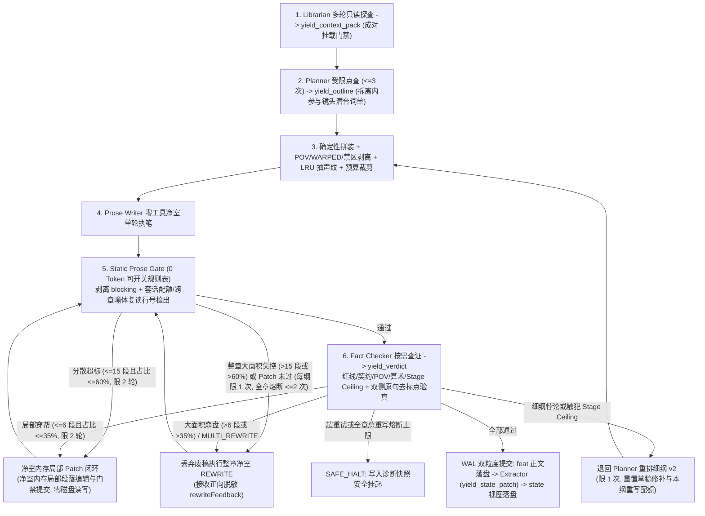

# NarrateOS 业务流与领域数据契约规范 (ARCHITECTURE)

> **定位**：面向长篇连载与单卷精品创作的通用多智能体写作业务规范。
> **阅读指引**：领域词汇与常量/变量基线见 [`../ROADMAP.md`](../ROADMAP.md)；微观文风与静态门禁词典见 [`WRITING-CRAFT.md`](WRITING-CRAFT.md)；DSH 插件拓扑、角色配置解耦与工程验收见 [`DEVELOPMENT-PLAN.md`](DEVELOPMENT-PLAN.md)；外部实证与底座备忘见 [`RESEARCH.md`](RESEARCH.md)。
> **规范状态**：本文定义目标业务流与数据契约；各插件与工具链的落地进度以 [`DEVELOPMENT-PLAN.md`](DEVELOPMENT-PLAN.md#4-分阶段施工序列与确定性完工判据) 及源码验证结果为准。

---

## 1. 架构公理与执行单元分工

长篇小说创作兼具自由文学表达与严格因果约束：**已归档手稿是唯一已发生剧情事实真源（`WAL`）**，物理排他状态、时空可达性、视角认知边界与句法配额共同构成确定性护栏。

### 1.1 四大业务公理

1. **单模同构公理（Bootloader 吃脏活，运行时零分支）**：不在运行时区分原创与同人分支。无论是零基础脑洞还是大体量外部设定包，均在开书阶段编译为统一标准作品工作区，运行时走同一套章节与维护管线。
2. **多轮探查、单轮净室写手与内存净室修补分离公理**：负责检索、规划、核查、抽取与周期整理的工种采用带受控作品工具的多轮探查形态，经专属 `yield_*` 终态门禁校验后交棒；负责初稿与整章重写的执笔写手（`Prose Writer`，含 `WRITER` / `REWRITE`）采用**无对话历史、零工具声明**的单轮净室调用；局部修补（`Patch`）升级为**净室内存段落编辑闭环**（纯内存局部段落编辑与门禁提交，零磁盘读写且继续物理隔离全知档案与宿主指令）。各工种统一通过原生会话隔离运行并独立复用自身前缀缓存，由可配置窗口预算（`writer_token_budget`）配合四级降级链抑制注意力稀释。
3. **纯文本数据库与双粒度事务公理**：每部作品独立存放于各自的 `books/<slug>/` Git 仓库。定稿手稿为最高事实真源（支持人工直接编辑并通过 `Sync` 平账），实体档案与目录为派生物化视图（遵循**环境补集原则**：相邻章尾窗可见的临时站位与动作不重复抄录）。单章正文落盘与视图更新拆为两次独立原子提交，由预写相位锁（WAL）保障崩溃恢复一致性。
4. **审美与字面校验权责分离公理**：严禁轻量模型评判文学审美优劣；凡确定性规则能判定的标签剥离、配额扫描、视角与禁区裁剪、外键可达性、固有属性保护与双侧原句存在性，统一由零模型开销的确定性规则层执行。

### 事实、设定与计划边界

- **正文事实**：已归档手稿是已发生剧情事实的唯一真源。实体后天状态、章卡与进度判断按正文派生；关键完成判断通过原稿回查核实。
- **初始契约与设定**：作者锁定的《作者契约》（`world/author_charter.md`）、世界规则与隐藏真相先于正文存在，按各自的可见范围提供给规划、审校与维护环节。
- **未来计划**：正向卷纲、导演禁区计划与世界惯性表记录后续目标、开篇节拍与成立前提。事件进入正文定稿后，方才更新实际进度与角色知情状态。
- **冲突处置**：派生视图偏离正文时修正视图；计划前提失效时在授权内调整后续路径；触及作者核心承诺或超出自动回滚授权时，在安全点挂起并呈交作者裁决。

### 共用作者对齐与双入口协同

开书构思与卷中重大改纲使用主对话协作入口；日常推进、连跑、微调信号投递与正文手改使用工作台面板（或零模型开销的操控命令）。作者拥有全知导演视角，写手始终接收经视角与禁区裁剪后的净室输入。

1. **取证与理据**：读取作者输入、外部参考资料、既有作品资产与有效契约，必要时联网考据行业与时代真实运作肌理。完成条件：可查明的背景事实已核实，每个拟提问项均对应影响主干的真实创作取舍。
2. **按依赖对齐**：先锁定原话具象锚点与世界边界，再按依赖关系提出前置条件已明确的选择，附备选代价与推荐方案；向作者全知摊开影响核心解法的底牌与阶段取舍，局部场景留给自动创作。完成条件：关键选择均获得作者拍板或明确授权覆盖。
3. **沉淀契约**：将确认后的核心承诺、当前方案与授权边界写入只读《作者契约》（`world/author_charter.md`）；上游决定变更时定位受波及资产并增量修订，保留仍成立内容。完成条件：每项确认要求均有对应资产落点，开放留白项边界明确，跨会话或重启后可无损接续。
4. **分权推进**：建库完成后自动切换至新书工作区并原地停机，由作者手动触发首章生成与日常推进；运行期工作台底部微调指令写入安全点队列（`.ops/signals.jsonl`）供后续工种消费，涉及改变核心承诺或扩展纠错权限时在安全点挂起等待裁决（主对话卷中重大改纲的受控资产写回工具与开书多 Agent 并行拆解属后续专项演进项，当前未实装）。

### 1.2 执行单元矩阵

各执行单元的模型池路由、工具白名单、调用配额与提示词通过外部声明式配置加载，各自跨章复用自身静态前缀缓存，支持跨厂商异构模型互审。

| 执行单元 | 运行形态 | 工具与视野边界 | 核心职责与终态交接门禁 |
| :--- | :--- | :--- | :--- |
| **确定性规则与仓储层** | 纯规则逻辑 (`0 Token`) | 持有 `.ops/tx.lock` 与 `StagingSession` | 排他锁与 WAL 双粒度提交恢复、POV/`WARPED`/契约与禁区文档物理剥离、声纹 `LRU` 轮换、四级预算降级裁剪、带时间差信封的跨称谓 `ripgrep` 回表、成对挂载校验、静态文风扫描、双侧原句去标点验真、固有属性锁与 1ms 外键可达性检查、零模型健康度遥测 |
| **1. Librarian 选页员** | 多轮受控探查工种 | 限目录只读 `book_glob / book_grep / book_read` | 基于管线预注入的 `world_state.md` 摘要、`L1_volumes`、`L2_cards`、前章末窗与带现状摘要的 `entityList` 锁定目标（不重读预注入及全知导演文件，`manuscripts/` 仅用 `book_grep` 定位切片），补齐二跳关联实体与冷宫唤醒名单；经 `yield_context_pack` 门禁核验成对挂载后交棒 |
| **2. Planner 章节导演** | 受限点查规划工种 | 挂载净菜包、`author_charter`、`arc_director_plan` 与 `craft_plugins`；硬限 `<=3` 次只读补查 | 结合开篇节拍、伏笔台账、`future_horizon`（含 `WARPED` 推演）与微调信号排定细纲；经 `yield_outline` 物理分离全知推演 `director_rationale` 与面向写手的 `outline_text`（含表面动作与当场表演潜台词指导，隐去谜底答案） |
| **3. Prose Writer 写手** | 单轮零工具净室 | 物理隔离秘密、`WARPED`、契约、禁区文档与宿主 `AGENTS.md`；受 `writer_token_budget` 管控 | 头部输出 100 字 `<blocking>` 空间走位自检，随后基于 `outline_text` 单轮输出停在具象感官画面的章节正文；触发 `REWRITE` 时仅接收经正向转写且物理脱敏的 `rewriteFeedback` 整章重写 |
| **3b. Patch 局部修补** | 净室内存编辑闭环 | 纯内存局部段落编辑与门禁提交（只读配额为 0、零磁盘读写）；同样物理隔离秘密、`WARPED`、契约、禁区与宿主档案，仅挂载脱敏出场实体视图、静态基线与细纲正文 | 基于 `0-based` 段落索引对分散超标或局部穿帮段执行非重叠区间替换（物理剥离禁区引用与禁用套词回显），内置实时 `StaticProseGate` 复核，违规归零且实际完成修改后提交定稿 |
| **4. Fact Checker 核查兵** | 按需查证审校工种 | 挂载本章草稿、可见状态、`author_charter` 与 `arc_director_plan`；可按配额只读查证旧细节 | **零审美评判**；核对先天伤残红线、POV 认知越界、专名冲突、算术闭合、作者核心契约及是否触犯 `Stage Ceiling` 禁区；经 `yield_verdict` 当场执行**双侧原句去标点存在性验真**（捏造引文直接打回重查） |
| **5. Extractor 记账员** | 定稿后抽取工种 | 在 `feat` 正文提交后运行；受控读取与状态补丁提交 | 基于已定稿正文提取实体状态变更（`PARALLEL` 模式分流至分支增量区）、双轨 `L2` 章卡与下章候选方向；经 `yield_state_patch` 校验新建实体中文标准名、固有属性锁与外键合法后完成 `state` 提交 |
| **6. Dreamer 整理员** | 多轮查证与暂存编辑工种 | 只读 `book_read / book_grep` + 隔离暂存 `book_edit`（禁碰 `manuscripts/`） | 跳过未出场干净实体；自主读取近期 `L2` 章卡并翻阅存疑原稿核实，在暂存区联动更新脏实体履历（兼顾声纹代谢）、伏笔台账、`WARPED` 惯性表（含 `Spotlight Trigger`）及卷纲节拍；经 `yield_dream_commit` 一次性校验锁与配额后原子提交 |

---

## 2. 作品工作区纯文本数据库结构与原子事务协议

每部作品的全部契约、设定、索引、实体视图与手稿真源均以 **UTF-8 纯文本（Markdown / YAML / JSONL）** 存储在独立的 `books/<book-slug>/` Git 仓库中：

```text
books/<book-slug>/                 # 独立 Git 仓库（与引擎源码物理隔离）
├── world/
│   ├── book_config.yaml           # [作品可配变量] 窗口预算、回滚阈值、叙述主观度、craft_plugins、model_routing、分角色 role_routing 与六大行为参数分组
│   ├── author_charter.md          # [作者契约] 核心承诺、排雷红线、原话 T0 锚点与授权边界（对 Writer 物理屏蔽）
│   ├── static_base_and_voice.md   # [写手静态基线] 世界底层法则、空间连通拓扑、叙述人称与抽象句法纪律（<=1,500 字）
│   ├── current_arc_envelope.md    # [写手正向卷纲] 当前卷公开舞台态势与正向主冲突（不含否定禁令词）
│   ├── arc_director_plan.md       # [导演禁区计划] 阶段天花板 Stage Ceiling、开篇 3~5 拍序列（带 [PENDING]/[DONE] 游标）与未揭拐点（对 Writer 屏蔽）
│   ├── ops_style_amendments.md    # [动态风格补丁] 卷中新增长期风格微调（换卷提炼合入 static_base_and_voice.md）
│   ├── world_state.md             # 全局日历锚点（含整数 story_day、当前卷号与 POV 体制）及宏观局势摘要
│   ├── future_horizon.md          # 世界默认惯性表（承载预定外部动态与 T0 后事件，超期 WARPED 折叠至底部 Archived WARPED 小节）
│   ├── open_threads.md            # 跨卷必收伏笔台账（活跃上限 <=15 条，不被 L0 纪元折叠裁除）
│   └── roles/                     # [可选单书覆盖] 针对本书微调特定工种的 YAML 配额或提示词
├── lore_library/
│   └── lore_*.md                  # 静态世界书词条与大体量分片设定（由 Librarian 按需挑页挂载）
├── index/
│   ├── L0_sagas.md                # 纪元折叠总表（每满 10 卷或完结时追加纪元汇总摘要）
│   ├── L1_volumes.md              # 活跃卷级总表（支持单卷完结作品 >=1 卷及多卷递进蓝图）
│   └── L2_cards/
│       └── vol_01_cards.md        # 按卷分片双轨章卡（主干剧情 + 异象锚点与出场实体 ID 索引）
├── entities/
│   ├── char_001.md                # 不可变 entity_id 命名：四段式角色档案（单一实体单文件可追溯，不拆分纪元分片）
│   ├── item_001.md                # 唯一性关键证物/道具档案
│   └── cold_archive/              # 仅在换卷时迁入的退场休眠角色档案（支持返场唤醒）
├── manuscripts/
│   └── ch_0001.md                 # [WAL 唯一真源] 剥离工程标签后的章节定稿（支持人工直接编辑）
└── .ops/
    ├── tx_state.json              # 原子事务预写相位锁（WAL）与章节 SHA-256 指纹表
    ├── voice_samples.yaml         # [动态声纹池] 0~N 条多语域表达示范（支持混合滚动置换与 LRU 轮换代谢）
    ├── signals.jsonl              # 工作台微调指令、Retcon 圆谎纸条与 Spotlight Trigger 队列（纯追加、支持安全撤回）
    ├── signals_cursor.json        # 信号消费幂等索引（记录已消费信号 ID 集合与兼容游标）
    ├── sync_conflicts.json        # 历史章手改触发的下游只读连续性冲突报告
    ├── heal_plan.json             # 跨章三级自愈重跑持久化断点（崩溃后支持一键续跑或回滚还原）
    ├── runs.jsonl                 # 各章工种与 Dreaming 运行的宿主 sessionId 索引（含 attempt / triggerReason，供节点轨迹与历史审计）
    ├── session_logs/              # 各会话落盘调试回放快照（<sessionId>.json：含 requestInput、usage、思维链与完整工具返回）
    ├── parallel_deltas/           # PARALLEL 并行时间线窗口内的分支状态与分支 L2 章卡增量暂存区
    └── telemetry.jsonl            # 每章零模型开销采集的健康度与缓存遥测流水
```

### 双粒度 Git 提交与 WAL 崩溃恢复契约

单章落盘拆分为两次独立原子提交，由 `.ops/tx_state.json` 记录相位（`DRAFTING -> FEAT_COMMITTED -> STATE_COMMITTED -> [DREAM_COMMITTED]`）：

1. **正文真源提交**：`feat(ch-0045): settle manuscript`（写入 `manuscripts/ch_0045.md` 并登记正文 `sha256`）。
2. **物化视图提交**：`state(ch-0045): update entity pages & L2 card`（状态变更过完固有属性锁与 1ms 外键可达性检查后提交；触发周期整理时追加独立的 `dream(ch-0045)` 提交）。

**崩溃恢复**：若进程在 `FEAT_COMMITTED` 后中断，重启自检跳过正文生成，直接从已提交正文启动 `Extractor` 补齐 `state` 提交；若仅状态提取有瑕，可单独回退 `state` 重算视图而无损保留正文。

---

## 3. 作者对齐、开书建库与开篇校准

遵循**自由构思深聊、严谨编译门禁、建完停机检阅、首章实测校准**：在主对话完成对齐并锁定契约后，后台完成资产编译与门禁验收即原地停机，交由作者手动启动第一章完成体验校准。

### 3.1 Phase 1：取证构思与《作者契约》收口

开书前的草案与讨论保存在 `books/` 之外的筹备区。针对原创种子或外部同人设定，按「3 必选底座 + 2 按需模块」收敛构思（目前作为基准方案落地，后续可通过开篇评测循环持续迭代构思策略）：

1. **舞台肌理取证与排雷**：结合联网考据或参考材料提炼 5~8 条行业/时代真实运行细节，让冲突长在具象机制上；显式列出并排除当前题材最廉价的默认套路（仅存入契约留档，对写手屏蔽）。
2. **三项必选底座**：
   - **契约、边界与 `T0` 原话现场**：锁定核心阅读回馈、世界物理/超自然边界、POV 切镜体制、叙述人称主观度、卷/副本尺度（支持单卷完结 `>=1` 卷），以及作者原话逐字锁定的 `T0` 开局现场。
   - **自主人物与外部压强**：为每个核心人物定义主线目标之外的**非主线私欲/软肋**与**有限信息下的合理误判**；明确驱动局势演进的外部惯性压强（人物行动，或自然气候、制度账期、生存规则）。
   - **首程弧光与无章号「开篇序列节拍（3~5 拍）」**：明确首卷收束新常态与 `Stage Ceiling` 阶段禁区，并将开局至第一幕转折拆解为 **3~5 个不绑死章号、按序消耗的节拍台阶**（每拍规定：体验/手艺落点、限量放出的 1~2 个线索、达成过拍的可见标志）。
3. **两项按需模块**：
   - **信息差与局部闭环**（悬疑/暗线/错位喜剧激活；明牌日常允许 `0` 黑幕）：跨卷终局允许留白（`OPEN_HORIZON`），但当前卷开篇摆上台面的核心异常必须具备第一层因果闭环（`Local Closure`）。
   - **多卷续航 / 同人魔改差值（`Canon Delta`）**：多卷连载明确跨卷新压强来源；大体量同人设定不做单次全量硬压，静态背景分片直入 `lore_library/`，开书仅对齐 `T0` 人际切面与原著魔改清单。
4. **常识因果自检与契约锁定**：收口前核验幕后方动机经济性、关键线索物理可达路径与主角不可替代手艺；经作者明确确认后锁定不可变构思快照。

**完成条件**：必选底座与已激活按需模块无缺项，`T0` 原话锚点与授权边界明确，作者显式确认锁定快照。

### 3.2 Phase 2：配置锚定与三把手术刀编译

前置校验目标作品空目录并获取初始化排他锁后，按作品配置 `world/book_config.yaml` 中的静态可配 `tokens_per_char`（默认 `0.6`，运行期不自动改写受版本跟踪的配置文件）作为预算换算基准，随后按三把手术刀将锁定快照编译为标准资产：

1. **视角与禁区刀**：将完整锁定契约写入只读 `world/author_charter.md`；将 `Stage Ceiling` 禁区、开篇 3~5 拍序列与未揭拐点写入 `world/arc_director_plan.md`；`world/current_arc_envelope.md` 仅写入对写手安全的正向舞台常态；可揭晓的 `OMNISCIENT_SECRET` 底牌统一放入第 2 区并绑定明确槽位键（第 1 区先天红线仅放 `PUBLIC` / `SELF_ONLY`），其余条目按知情范围分入 `PUBLIC / SELF_ONLY / OMNISCIENT_SECRET / READER_KNOWN`。
2. **时序刀**：以锁定的 `T0 / story_day = 0` 为锚点，开局前既成事实与在场状态写入 `entities/` 与 `world_state.md`；`T0` 后预定动态写入 `world/future_horizon.md` 并附成立前提与触发窗口。
3. **冰山与声纹刀（混合滚动置换 `hybrid_rolling`）**：常驻法则与抽象句法纪律写入 `world/static_base_and_voice.md`（`<=1,500 字`），背景资料切入 `lore_library/`；若作者提供样章则优先提取过门禁的多语域原句入 `.ops/voice_samples.yaml`（永久保留）；若无预设样章，按配置策略（默认 `hybrid_rolling`）生成 `3~4` 条分属不同语域标签、15-45 字含具体生活动作或口语交锋的短临时种子（严禁空洞景物抒情假句），并在前 `voice_rolling_warmup_chapters`（默认 `3`）章定稿后由真实章内好句一对一替换退场。

**完成条件**：全部标准目录与资产文件生成完毕，实体 ID 与词条 ID 各自唯一，写手可见文件零禁令词与零未揭底牌，完整保留开书编译会话轨迹供工作台回放。

### 3.3 Phase 3：初始化门禁验收与建库停机

1. **确定性结构与门禁核验**：校验 `entities/` 中无 `story_day > 0` 未来泄露、待唤醒 `open_threads` 未在 `day:0` 公开栏提前泄底、`future_horizon` 近期事件与 `L1` 卷跨度相容，并对实体文本与世界摘要运行 `StaticProseGate` 去套话检查。
2. **契约守恒与信息边界核验**：对照 `author_charter.md` 核对 `T0` 时刻/地点/持有物一致性、首卷局部因果闭环及公开视图零剧透（外部同人核心设定与专名守恒率 `>=98%`）。编译偏差自动回编译修正；触及契约自身矛盾时退回主对话请作者裁决。
3. **初始提交与停机交付**：验收全部通过后初始化 `.ops/tx_state.json`（`last_committed_ch = 0`），执行初始 Git 提交，由 `lock_charter_and_boot` 自动触发 `switchBook` 激活新书工作区（若遇在途锁冲突则保留已落盘建库结果），通知工作台刷新书目并**原地停机**。

**完成条件**：作品 Git 仓库初始提交成功且工作区干净，系统处于空闲待命态，等待作者检阅资产并手动触发第一章。

### 3.4 Phase 4：正式开篇校准与滚动声纹置换 (`Voice Harvest`)

1. **首章启动与可选停机**：作者检阅建库资产后启动第 1 章生产（仅消费配置上限 `first_chapter_max_beats` 默认第 `1` 拍），按第 5 节正式流程完成审校与双粒度归档；当配置项 `opening.pause_after_chapter_1` 为 `true`（或作者手动校准）时，首章定稿后自动停机等待体验检阅，与声纹初始化策略完全解耦。
2. **体验核对与按因修订**：作者审阅第 1 章的人物气口、节奏、描写密度与线索释放量。纯字句润色直接保存并执行 `Sync`；涉及表达纪律、人物动机或节拍偏差时修订对应资产并修补或重跑首章。
3. **声纹采血与前 N 章滚动置换**：在 `hybrid_rolling` 模式下，前 `voice_rolling_warmup_chapters`（默认 `3`）章每章定稿并完成状态抽取前，若池内仍存在临时种子，自动从刚定稿正文提取语域互补、脱专名且通过 `StaticProseGate` 的真实好句一对一替换掉临时种子；若池内为空且确认进入后续推进，亦可自动或手动从 `ch_0001.md` 提取 `3~5` 句纯表达示范入池。

**完成条件**：`ch_0001.md` 及关联状态同步一致，声纹池完成校验入库或按滚动策略完成置换，作者下达后续推进或 YOLO 连跑指令。

```mermaid
flowchart TD
    A["主对话构思取证与因果自检"] --> B["作者锁定契约快照"]
    B --> C["三把手术刀编译与门禁验收"]
    C -->|编译偏差自动修正| C
    C -->|通过并完成初始提交| D["建库原地停机 (待作者检阅启动)"]
    D -->|启动第 1 章 (仅第 1 拍)| E["第 1 章归档 (按 pause_after_chapter_1 可选停机)"]
    E -->|在线改稿 Sync 或修订设定重跑| E
    E -->|确认或推进 (前 N 章滚动置换 boot_seed)| F["日常推进 / YOLO 连跑"]
    F --> G["后台多工种按章生产 (安全点消费微调信号)"]
    G --> H["多轮 Dreaming 核实原稿并联动维护资产"]
    H -->|授权内维护完成| G
    H -->|卷末收束兑现| I["advanceVolume 换卷或完结封笔"]
    I -->|开启新卷| G
    H -->|触碰核心承诺或超限冲突| J["安全点挂起请求作者裁决"]
    J --> F
```

---

## 4. 前缀缓存、补集视图与确定性隔离契约

### 4.1 工种独立前缀复用、灰象双视图与四级降级链

1. **各工种跨章自复用前缀缓存**：
   - 每个工种拥有各自稳定的系统指令与工具声明，在同卷有效版本内跨章命中自身前缀缓存；静态资产修订提交后切换至新版本。
   - **`Planner` 规划输入**：系统规划指令 + `author_charter.md` + `static_base_and_voice.md` + `current_arc_envelope.md` + `arc_director_plan.md` + `world_state.md` 摘要 + 按需挂载的 `craft_plugins`、`future_horizon.md`（含 `WARPED` 原委）与 `Librarian` 交付的净菜包。
   - **`Prose Writer` 净室输入**：零工具系统执笔指令 + `static_base_and_voice.md` + `current_arc_envelope.md`（正向卷纲）+ 动态尾部的 `ops_style_amendments.md`、`outline_text`、`LRU` 抽出的 1 条 `voice_samples` 标本、挑出的 `lore_library` 词条、经 POV 与时间线物理裁剪后的出场实体视图、相邻章衔接文本与当章微调信号。
2. **禁区与灰象双视图物理隔离（防粉红大象词法反噬）**：
   - `author_charter.md`（含排雷禁词）、`arc_director_plan.md`（含 `Stage Ceiling` 禁区）及 `future_horizon.md` 中因前提破灭翻转为 `WARPED` 的条目仅向规划、审校与维护工种暴露；
   - 为 `Prose Writer` 拼装请求时，**物理剔除上述禁区文档、一切 `WARPED` 条目及未揭底牌**，确保写手窗口内只存在正向具象戏码。
3. **可配置预算四级降级链（Context Eviction Pipeline）**：
   - 写手窗口上限由 `book_config.yaml` 的 `writer_token_budget` 控制（未配置或未超标时无损放行）；超出预算时按固定顺序压缩：① 将“上一章全文”降级为「上章 `L2` 摘要 + 末尾 600 字尾窗」；② 将 `background_cast` 压缩为单行简卡；③ 缩减可选 `L3 ripgrep` 切片（每个必需证据章至少保留 1 条）；④ 缩减可选 `lore_library` 词条。若四级压缩后必需证据仍超预算，明确报错停止生成，严禁静默删减必需证据。

### 4.2 四段式实体档案（补集原则）、潜台词指导与解密翻转

实体档案遵循**环境补集原则**，所有时序条目携带整数日历 `story_day`（`T0 = 0`，开局前历史为负数）：

```markdown
---
entity_id: char_002
canonical_name: 神代雪乃
unique_aliases: ["雪乃", "冰山副会长", "神代大小姐", "神代同学"]
contextual_titles: ["副会长", "风纪委员长", "铁血委员长", "学姐"]
historical_anchors: ["ch_0002:四楼锁窗女生"]
last_seen_ch: 45
---

## 1. Innate Locks (先天/底层永久红线 · since_day: -inf · 插叙永不屏蔽)
- [vis: SELF_ONLY] 极度怕黑，无光源密闭环境下无法独自行动 [锚点 ch_0008]
- [vis: PUBLIC] 右手腕内侧有旧烫伤浅疤

## 2. Acquired State & Numeric Ledger (跨章后天状态与数值账本 · 行级更新)
- [day:12 | ch:45 | vis: PUBLIC] 持有物：item_001（黄铜钥匙）；驻留节点：学生会室
- [day:5 | ch:16 | vis: SELF_ONLY] 主观认知偏差：误信琉璃台词谎言，以为《月光》旧琴谱已烧毁
- [day:-1095 | ch:01 | vis: OMNISCIENT_SECRET] 隐藏底牌：三年前亲手锁死四楼音乐室真相
- [Tracked Numeric Ledger] 社团剩余经费: 1200日元 | 备用钥匙数: 1

## 3. Irreversible Trajectory (不可逆极性变迁史 · 纪元内禁删)
- [day:-1095 | ch:21] (插叙揭露) 曾在四楼音乐室门框悬挂风铃
- [day:0 | ch:01] 签发废部通知，立下周五核查赌约
- [day:3 | ch:10] 从男主手中收回黄铜钥匙锁入铁柜

## 4. Recent Sliding Buffer & Voice (近期跨章缓冲与专属声纹)
- [day:12 | ch:44] 发现铁柜锁舌新划痕，确认钥匙仍在
- 对话声纹：句式工整克制，禁用流行俚语，习惯拿校规掩饰真实意图
  > 标本：「我只是按章办事。至于六点以后谁去四楼锁窗，排班表恰好翻篇了。」
```

- **POV 物理剥离与表演潜台词指导（兼顾防泄底与对手戏机锋）**：
  - 面向 `Prose Writer` 与局部 `Patch` 的净室裁剪路径对非当前 `pov_character` 物理剔除 `vis: SELF_ONLY`，对全员无条件剔除 `vis: OMNISCIENT_SECRET`（未知或异常 `vis:` 标签按 Fail-Closed 默认丢弃），将 `vis: READER_KNOWN` 转化为 `[仅读者已知的戏剧张力点]`，并隐去内部槽位/权限工程标签；`Planner`、`Fact Checker` 与 `Extractor` 视图保留完整工程标签以保证精确核对与回写。
  - 细纲强制拆分为 **`director_rationale`（全知因果推演，对写手物理丢弃）** 与 **`outline_text`（面向写手的镜头与当场表演潜台词单）**：在高密度试探或智斗戏中，`outline_text` 须写明角色当场的表面动作与试探张力（如视线落点、话锋施压方向），同时严禁直白写出尚未揭晓的谜底事实。
- **`OMNISCIENT_SECRET` 原地解密翻转闭环**：一切可揭晓的 `OMNISCIENT_SECRET` 底牌统一置于第 2 区 `Acquired State` 并绑定明确的 `slot_key`（第 1 区 `Innate Locks` 仅放 `PUBLIC` / `SELF_ONLY` 先天红线）。剧情抵达正式揭秘节点时，`Planner` 将本次揭晓内容写入 `outline_text` 交写手正面呈现；定稿后 `Extractor` 对同一 `slot_key` 原地将可见性翻转为 `PUBLIC` 或 `READER_KNOWN`（可选追加第 3 区公开记录），确保后续章节正常继承既成事实。
- **入库锁、别名归并与路人缓建档**：状态提交严查 `Innate Locks` 防篡改、新建实体必填标准中文 `canonical_name` 与外键可达性；揭晓马甲时通过 `unique_aliases` 归并原卡；临时路人未跨章复现且未关联 `open_threads.md` 前仅记于 `L2` 备注。

### 4.3 `L0-L3` 分级目录与成对 `ripgrep` 回表

1. **双轨 `L2` 章卡、非幽灵合成与定长冻结折叠**：每章持久化 `主干剧情`、`异象锚点`（0-8 个正文逐字出现微物件/数字锚点；若至少 1 条命中正文则过滤未命中词放行，全 0 命中至多打回重抽 1 次防死循环）与 `出场实体`（严格由视角人物、细纲 `focus_cast`/`background_cast`、状态补丁涉及实体与在场交互实体确定性合成，严禁将远方对话提及的幽灵角色自动写入）；当当前卷章数超过阈值（`l2_full_unfrozen_threshold`，默认 `40` 章）时，对早期章节按定长块（`l2_freeze_block_chapters`，默认每 `20` 章）冻结折叠为单行索引以稳定前缀缓存，近期章节保留完整双轨视图。
2. **跨称谓 `L3` 原稿回表与段级限流**：展开 `canonical_name + unique_aliases + historical_anchors` 全文扫描；通用职务称谓 `contextual_titles` 限定在 `L2` 已登记该角色出场的章节白名单内执行段级共现检索（按 `focus_chapters` 优先与关键词共现打分，单实体默认上限 3 条、单章总包上限 12 条，每个必配证据实体锁定至少 1 条首选切片免于第 3 级裁剪），返回切片顶部硬套时间差信封：`[出自第 03 章 (day:1) | 距当前第 45 章 (day:12) 已过 42 章 / 11 天 - 历史现场非当前归属]`。
3. **伏笔与证物成对挂载（含首秀豁免）**：仅当目标实体在当前章之前的可达定稿章中确有历史出场记录或历史锚点时，凡触及 `open_threads.md` 回收、唯一道具重现或故地重游，方强制在 `yield_context_pack` 门禁中核验同时挂齐「实体/设定视图 + 至少 1 段 `L3` 原稿切片」；尚未在历史正文出场的预建实体首次登场直接豁免。手填切片强制核验路径可达性与原稿去标点逐字存在性并加盖时间差信封。

---

## 5. 单章生产闭环、手改同步与三态时间线

### 5.1 弹性章长与多工种审校内环

单章字数由 `Planner` 按戏核分量在弹性区间（参考 `1,800-6,500 字`）自决。



### 5.2 微调信号、优雅停机与手稿真源增量同步 (`Sync`)

1. **安全点微调信号队列与双档停机**：工作台底部输入栏或操控命令投递的微调指令（`DIRECTOR_NOTE`、`SPOTLIGHT_TRIGGER` 与 `RETCON`，建议时间线模式支持 `MAINLINE` / `PARALLEL` / `FLASHBACK`）纯追加存入 `.ops/signals.jsonl`，支持未消费信号撤回；信号仅在对应章节状态提交成功后原子标记为已消费，超期非 `RETCON` 信号按回溯窗口自动过期。默认停机请求等待在途原子提交完成后于安全点平稳退出，仅应急强制中断模式立即中止在途调用并由 WAL 回滚。
2. **手稿同步四分支确定性协议**：人工直接修改或新增 `manuscripts/ch_*.md` 并触发 `Sync` 时，全程在单次排他锁内按确定性四步执行：
   - **预检拒止**：拒绝跳号未跟踪手稿（`> last_committed_ch + 1`）以及活跃 `PARALLEL` 并行窗口开放期间的主线修改；
   - **Step 1（历史脏章升序刷新 `L2`）**：先按章号升序处理所有历史脏章（`< last_committed_ch`），按 `L1_volumes.md` 与章卡所在卷精准定位所属卷双轨 `L2` 卡刷新摘要、锚点与指纹，**严禁对历史旧章重放状态补丁覆写最新实体第 2/4 区或 `world_state.md`**（检出设定差异记入咨询建议）；
   - **Step 2（最新章或顺次新章）**：若仅最新章纯字词润色且无历史脏章，零重抽刷新指纹直接放行；若涉事实变更或顺次新章，保留原章时间线上下文（严禁把 `FLASHBACK` 最新章误按 `MAINLINE` 写回），刷新实体状态（`MAINLINE` 同步世界状态）、所属卷双轨 `L2` 卡与下章候选方向；
   - **Step 3（单次原子落盘）与 Step 4（下游只读冲突扫描）**：统一单次原子提交全部视图变更；存在历史脏章时，先提取历史脏章涉事实体与锚点词经索引检索筛出关联下游章节并按字符预算分批扫描，每条上报冲突必须同时通过**历史脏章原句与下游受波及章原句的双侧去标点验真**，实锤结果落盘 `.ops/sync_conflicts.json` 只读返回，**严禁后台静默篡改下游手稿**。

### 5.3 三态时间线读写隔离沙盒 (`timeline_mode`)

| 模式 | 适用场景 | 起草与探查裁剪规则（确定性执行） | 归档状态写回规则 |
| :--- | :--- | :--- | :--- |
| **`MAINLINE`** | 常规顺叙推进 | 挂载 `Innate Locks` + 可见 `Acquired State` + 变迁履历 + 近期缓冲 | 更新主线实体第 2-4 区并推进 `world_state.md` 的 `story_day` |
| **`PARALLEL`** | 同一时间窗切换异地多视角 | 显式分叉打标签 `git tag parallel-fork-{id}`；仅读取分叉快照加本支线增量，过滤其他支线章卡与切片；开放期间拒绝主线 `Sync`、`Dreaming` 与换卷 | 支线状态与支线 `L2` 章卡暂存于 `.ops/parallel_deltas/`，**冻结主线 `story_day` 重复累加且不迁回冷宫实体**；显式执行三方合并（硬拦截唯一道具双线冲突）后统一合入主线并推进时钟 |
| **`FLASHBACK`** | 插叙过往回忆或倒叙 | 保留 `Innate Locks`；**物理屏蔽当前 `Acquired State`、近期缓冲及不连续的主线未来章尾窗**，仅挂载 `day < target_day` 的历史履历 | **严禁覆写当前 `Acquired State`、近期缓冲、冷宫实体或推进主线 `story_day`**；新揭露往事仅带历史 `story_day` 追加至第 3 区履历与相关知情者认知层 |

### 5.4 阅读节奏控制、候选接力与 `Plot-Haystack` 探针

- **六项戏剧质感锚点**：① 单章聚焦 1~2 个连续场景与唯一慢放戏眼（`Spotlight`），细纲必填无题材偏见的 `chapter_turn`（实质预期偏差、视角新转折或关系位移）；② 将 `READER_KNOWN` 信息差转化为桌下炸弹提示；③ 仅在非 `FLASHBACK` 模式下，当 `current_ch - last_seen_ch > wakeup_gap_chapters`（默认 `30`）时自动注入半句感官特征唤醒记忆；④ 时空紧接章挂载上章原文（超预算降级为摘要+尾窗，`FLASHBACK` 模式不注入不连续的主线尾窗）；⑤ `HOOK / AFTERGLOW / CLOSURE` 三态具象画面收尾；⑥ `Extractor` 随章产出 2~3 条 `next_chapter_options`（带源章号记录）供单步/连跑接力或人工点选。
- **40 章盲测基准（`Plot-Haystack Benchmark`）**：于 Ch.01-05 预埋 10 枚探针（3 组极性反转、3 条低语义关联负向红线、2 处台词谎言分流、2 个跨 35 章伏笔），于 Ch.36-40 检验零硬穿帮率、`100%` 成对召回率与熵率稳定性。

---

## 6. 多轮睡眠整理 (`Dreaming`)、跨章自愈与换卷交接 (`advanceVolume`)

### 6.1 多轮查证、隔离暂存编辑与原子提交 (`Dreaming`)

当累计新增定稿字数或活跃实体第 4 区缓冲达到配置水位（或作者手动触发）时，在 `STATE_COMMITTED` 安全相位且无开放 `PARALLEL` 窗口前提下启动多轮 `Dreamer`：

1. **按脏页准入与原稿回查**：未出场干净实体零读取零修改（保持文件 `mtime` 不变）；`Dreamer` 通过受控只读工具读取上次水位以来的新增 `L2` 章卡、`author_charter.md`、`arc_director_plan.md`、`open_threads.md` 与 `future_horizon.md`，对疑似兑现的伏笔或阶段节点**主动翻阅对应章节原稿段落核实**。
2. **隔离暂存区多文档联动编辑（`book_edit`）**：所有修改写入本轮独占的内存暂存区（后续 `book_read` 自动读取暂存新版本，严禁触碰 `manuscripts/`）：
   - **实体履历提炼、微物件升格与声纹代谢**：将达水位脏实体的第 4 区缓冲提炼入第 3 区变迁履历（保留原章锚点与角色专属声纹），巡检近期双轨 `L2` 章卡中跨 `>= promote_anchor_min_chapters`（默认 `2`）章复现的未建卡异象锚点升格建卡或归并马甲别名；结合退化遥测淘汰 `.ops/voice_samples.yaml` 中复读超标的陈旧口癖标本并经静态门禁检验后补充近期优质定稿句式；
   - **伏笔台账盘点（`open_threads.md`）**：将经原稿核实已兑现的伏笔翻转为 `RESOLVED` 归档，登记新跨章悬念（单次新增 `<=2` 条、全局活跃总数 `<=15` 条）；
   - **惯性表折叠与前台切镜（`future_horizon.md`）**：前提破灭节点翻转为 `WARPED`，超期（默认 `3` 天）死元组折叠归入 `world/future_horizon.md` 底部 `## Archived WARPED` 小节（不再写入 `entities/cold_archive/`）；长期退场角色不在卷中搬迁，统一留待换卷阶段归档冷宫；离场重要角色蓄力抵达即将改变局势的冲突临界点时，严禁后台一行结算，向 `.ops/signals.jsonl` 投递 **`Spotlight Trigger`（前台切镜信号）** 交后续章节正面叙事；
   - **导演节拍维护与静态前缀保鲜**：对照正文证据维护 `arc_director_plan.md`（更新开篇节拍 `[DONE ch_XXXX]` 状态与后续路径微调）；**常规卷内整理不改写 `current_arc_envelope.md` 与 `static_base_and_voice.md` 以保鲜写手静态前缀缓存**；若路径失效且修正需改变 `author_charter.md` 核心承诺，则中止提交并在安全点挂起请作者裁决。
3. **终态门禁原子落盘（`yield_dream_commit`）**：一次性对暂存区全部变更执行确定性校验——拦截任何针对活跃与冷宫档案 `Innate Locks` 或 `canonical_name` 的篡改、校验声纹静态门禁与活跃伏笔 `<=15`（单次新增 `<=2`）配额及外键合法性；违规项精准报错令 `Dreamer` 当场继续修妥，全部通过后一次性落盘、将 `.ops/dream_watermark.json` 累计新增字数清零并完成 Git `dream` 提交。

**完成条件**：所有脏页、伏笔、惯性节点与导演节拍均与最新归档正文一致，门禁零违规且单次 `dream` Git 提交落盘完毕。

### 6.2 跨章穿帮三级全自动梯度自愈

连续性审计上报疑似跨章冲突时，先执行**双侧原句去标点存在性代码验真**与合法转移核查（捏造引文或合法转移直接静默丢弃），实锤冲突采用分段持锁策略按三级梯度处置：

1. **软微瑕（天气体感口误、次要环境微差）**：短锁内向 `.ops/signals.jsonl` 追加 `RETCON` 信号由下一章顺嘴圆回，**0 停机**。
2. **单点硬穿帮（生死/唯一物/地理硬冲突，且下游未依赖该错误事实）**：在同一事务锁内完成净室内存局部 `Patch` 修补、静态门禁复核、手稿写回与所属卷双轨 `L2` 章卡/指纹刷新并原子提交，**0 停机、0 废章、无拆锁竞态**。
3. **连带支线硬穿帮（下游章节建立在该错误事实之上）**：对照 `book_config.yaml` 的 `max_auto_rollback_chapters`：
   - **波及章数 `<=` 阈值**：短锁内快照保留未消费及未来章信号与有效声纹、打 `backup/pre-heal-*` 备份标签、`reset` 回冲突前章节并清理回滚带出的脏锁文件、合并写回保留信号与正向重跑约束、写入持久化自愈断点 `.ops/heal_plan.json` 后释放事务锁；随后在无外锁下逐章正常推进重跑（每章独立持锁提交并更新断点，崩溃后支持一键续跑或从备份还原）；
   - **波及章数 `>` 阈值（或重跑仍失败）**：写入完整物理量诊断快照触发 `SAFE_HALT`（输出冲突双侧章号行号、原句、波及章数与总字数）。

### 6.3 零模型健康度遥测

每章定稿后纯规则采集指标写入 `.ops/telemetry.jsonl`：细纲重排率（`replan_rate`）、语言退化四联指标（**`MATTR-500`** + **Kontoyiannis 熵率 $\hat{H}_K$** + **句段长变异系数 CV** + **AI 套话千字命中密度**）、故事时钟推进及各工种 Token 与缓存命中率。

### 6.4 五步原子换卷交接 (`advanceVolume`)

当本卷收束标志已由正文兑现（或作者裁决确认交接）且无开放 `PARALLEL` 并行窗口时，执行五步原子交接：
1. **封存旧卷与纪元折叠**：将第 $k$ 卷实际收束摘要与 `story_day` 跨度写回 `index/L1_volumes.md`；每满 `saga_fold_volume_interval`（默认 `10`）卷或全书完结时，向 `index/L0_sagas.md` 追加一段旧纪元汇总摘要（保留未结 `open_threads`；单实体履历保持单文件不拆分 `*_saga_XX.md`）；旧卷 `vol_{k}_cards.md` 转为只读历史索引，非完结时新建 `vol_{k+1}_cards.md`；
2. **旧舞台角色冷归档**：将非伴随旧地图角色批量移入 `entities/cold_archive/`（仅在换卷阶段统一归档；后续返场时先加载入内存快照，若主线推进产生状态变更则合并原 `Innate Locks` 后迁回 `entities/`）；
3. **提炼合入风格修订**：将 `world/ops_style_amendments.md` 去重提炼合入 `world/static_base_and_voice.md`（总长校验 `<= static_base_max_chars` 默认 `1,500` 字，禁止暴力硬截断）并清空修订表；
4. **完结封笔 vs 新卷双文件结构化编译**：
   - **完结封笔**：若已走完终局卷且无续写计划，将开放悬念标为 `OPEN_ENDING`；
   - **新卷展开**：注入 `author_charter.md`、`L0_sagas.md`、`L1_volumes.md`、当前实体状态与未结伏笔，物理拆离编译下一卷对写手安全的正向 `current_arc_envelope.md`（兜底剥离受限禁区词）与全知 `arc_director_plan.md`（承载下卷 `Stage Ceiling` 与新开篇节拍）及近期 `future_horizon.md`（需改变核心承诺时挂起交作者裁决）；
5. **推进卷游标、显式受控提交与后置标签**：递增 `world_state.md` 的 `current_volume`，登记写前写集后仅显式提交本次受控资产变更（严禁提交 `.ops/` 运行态锁或日志），**提交成功后方打 `arc-seal-vol-{k}`（及完结时的 `novel-completed`）标签**。

---

## 7. 机制常量与可配变量总表

| 分类 | 固化的机制常量（跨书恒定护栏） | 开放的可配变量 / 声明式配置项 |
| :--- | :--- | :--- |
| **工种与缓存** | 多轮探查工种经 `yield_*` 门禁收口；写手（`WRITER` / `REWRITE`）零工具单轮净室，`Patch` 为纯内存段落编辑闭环（零磁盘读写）；各工种统一经原生会话隔离运行并独立复用自身前缀缓存；四级预算降级顺序 | `roles/*.yml` 与 `prompts/*.md`（模型池、工具白名单、只读次数上限、提示词）、`tokens_per_char`、`writer_token_budget`、`model_routing` 与分角色两层 `role_routing` 覆盖、`repair_loop` 双轨配额分组 |
| **契约与隔离** | 手稿 `WAL` 真源与双粒度分离；`author_charter`、`arc_director_plan` 与 `world/roles/**` 对 AI 工种硬只读/屏蔽；四段式补集结构；POV、`WARPED`、第 2 区底牌原地翻转与异常 `vis` Fail-Closed 剥离；固有属性锁与外键校验 | 作品 POV 切镜体制、卷/副本尺度、远期留白范围、`context_assembly`（尾窗字数、重逢唤醒章距、静态基线字数上限）、`retrieval`（切片限流、L2 冻结阈值、目录窗口） |
| **文风与群像** | `hybrid_rolling` 声纹与 `LRU` 抽样及 `Dreaming` 代谢；可开关 `Static Prose Gate` | `opening`（`voice_seed_mode`、池容量、滚动暖机章数、独立 `pause_after_chapter_1` 开关、首章节拍上限）、叙述人称与主观度基线、`.ops/voice_samples.yaml` 标签与标本、`prose_gate` 规则阈值、外置 `plugins/craft/*.yaml` (`craft_plugins`) |
| **时序、维持与自愈** | 三态时间线隔离与三方合并；`Spotlight Trigger` 前台镜头原则；双原句代码验真；历史章手改只读下游冲突扫描；分段锁 `Heal` 与软硬双档停机 | `dreaming`（`word_threshold`、`buffer_limit`、活跃/新增伏笔上限、超期 `WARPED` 天数、锚点升格章数、`saga_fold_volume_interval`）、`ops_and_sync`（锁超时、信号回溯窗口、扫描批字符上限、回滚检索深度）、`max_auto_rollback_chapters`、`parallel_max_chapters` |
